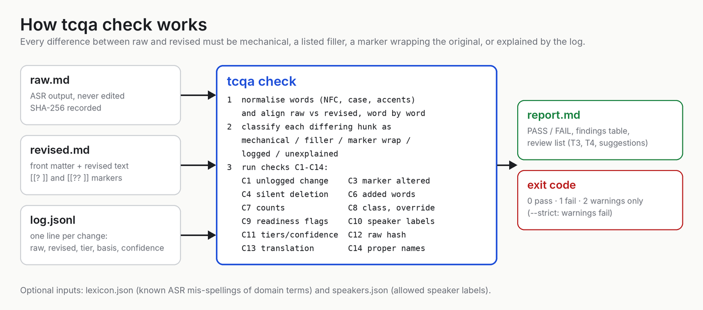
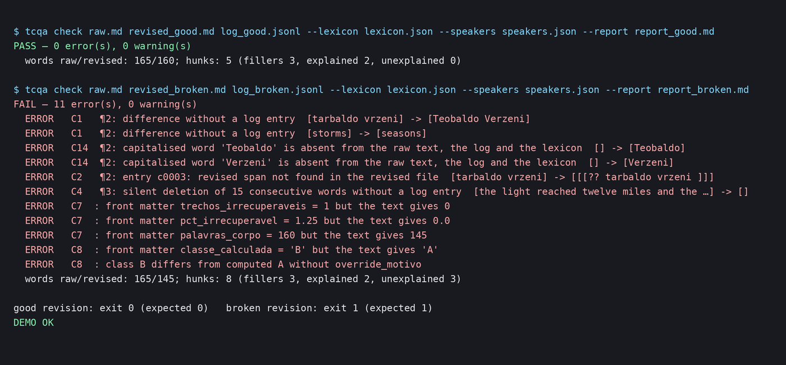

# transcript-corpus-qa

**Check that a corrected speech-to-text transcript changed only what it says it changed, before the text goes into a RAG or fine-tuning corpus.**

[](https://github.com/junqueirach/transcript-corpus-qa/actions/workflows/ci.yml)
[](LICENSE)


## Why this exists

Garbage in, garbage out. A corpus of talks, podcasts and interviews starts as
speech-to-text output: no punctuation, mis-heard names, fillers, and on bad
audio whole sentences that mean nothing. Somebody — a person or a model — has
to revise it before it is worth retrieving from or training on.

The danger is not the rough transcript. The danger is the *fluent* revision:
a corrected transcript can silently invent text. A destroyed name gets a
plausible one, a sentence that made no sense gets rewritten into one that
does, a whole paragraph disappears because it was "repetitive". Nothing looks
wrong. The corpus now attributes to the speaker words the speaker never said.

`tcqa` is a small offline tool plus a written method that make this
impossible to do unnoticed. Every change that is not mechanical must be in a
log with its justification, and anything the reviser could not recover must
be **marked, with the original words kept inside the mark**, instead of
filled in. The checker compares raw and revised word by word and refuses any
difference the log does not explain.

> A marked doubt is better than a reconstructed guess.

## How it works



`tcqa check raw.md revised.md log.jsonl` aligns the two texts word by word
(Unicode-normalised, case- and accent-insensitive), sorts every differing
span into *mechanical*, *filler/noise*, *marker wrapping the original*,
*explained by a log entry* or *unexplained*, and then runs fourteen checks:
unlogged changes, silent deletions, added words, altered markers, front-matter
counts, quality class, readiness flags, speaker labels, tiers and confidence,
raw-file hash, translation parity and a proper-name guard. It writes a
Markdown report with a review list of the risky corrections (outside-knowledge
fixes, cross-file fixes, every suggestion the reviser was not sure about), so a
human can review a file in minutes instead of re-reading it.

## Quick start

```
git clone https://github.com/junqueirach/transcript-corpus-qa
cd transcript-corpus-qa
python -m pip install -e .
python examples/run_demo.py
```

The demo (invented text, a talk about a lighthouse that does not exist) runs the
checker on a good revision and on a deliberately broken one:



The broken revision has three silent violations: a destroyed name replaced by
a plausible invented one, `storms → seasons` (a fluent wrong word) and one
sentence deleted. All three are caught (C1, C14, C4), and the front-matter
counts that no longer match the text are reported as well (C7, C8).
`examples/README.md` explains each file.

Commands:

| Command | What it does |
|---|---|
| `tcqa check RAW REVISED LOG [--lexicon L] [--speakers S] [--report R.md] [--strict]` | the fidelity check; exit 0 pass, 1 fail, 2 warnings only |
| `tcqa validate-log LOG` | validate a log on its own (schema rules, tiers, confidence, markers, overrides) |
| `tcqa classify REVISED [--write]` | compute the class, counts and flags from the text; detect the language; `--write` fills the front matter |
| `tcqa index build FOLDER` / `tcqa index audit indice.csv` | rebuild an index from front matter, or audit an existing one (durations, unlinked translations, flags that contradict the rules, unsafe file names) |
| `tcqa backup FILES --backup-dir DIR [--root ROOT]` | copy raw files to a backup folder, mirroring sub-folders, never overwriting (`name_001.md`, ...); prints the SHA-256 |
| `tcqa summarize LOG [--out X.md]` | generate the human-readable summary from the log |
| `tcqa hash FILES` | SHA-256 of files, for `raw_sha256` |
| `tcqa lexicon hits RAW --lexicon L` | the lexicon entries (and near-matches) that occur in one raw file |
| `tcqa lexicon validate\|stats\|merge\|learn` | check a lexicon (duplicates, ambiguous or common-word error forms); merge lexicons; grow one from finished logs (`learn --write`: new ASR forms of known terms automatically, new terms to a pending file for approval) |
| `tcqa draft-log RAW REVISED [--log L]` | write the log's bookkeeping: header, bulk counts, one stub per unexplained difference and marker; stubs (`basis: TODO…`) fail the check until completed |
| `tcqa review build FOLDER` / `tcqa review apply QUEUE.json` | one grouped human review queue for a run (T3/T4, suggestions, new speakers); apply the decisions back to the files |
| `tcqa export FOLDER --out chunks.jsonl [--lexicon L]` | RAG-ready chunks with metadata (speaker, role, channel, source URL, class, markers, terms, topics); ads left out by default |
| `tcqa metrics FOLDER [--csv C] [--baseline B]` | measure a run (entries per tier, markers, review load, speaker naming) to compare versions |
| `tcqa index summary FOLDER\|indice.csv` | corpus dashboard per folder: classes, readiness, main-author participation |

> **Start with a lexicon.** Without one, domain names and terms can't be fixed from a
> trusted source: they are only corrected when the context makes them certain and are
> otherwise marked, and the checker rejects capitalised words it can't trace (C14).
> `tcqa lexicon validate` checks yours; `tcqa lexicon learn` grows it from every run.

## The method in one page

Full text in [`docs/METHOD.md`](docs/METHOD.md).

**Markers.** `[[? original ]]` for a suspected error whose sense is still
readable, `[[?? original ]]` for text that cannot be recovered, and
`[[? original ⟶ suggestion: proposed reading ]]` when the reviser has a guess
but no certainty. The original text always stays intact inside the brackets;
the checker verifies it.

**Tiers.** Every logged correction says where its justification comes from:
T1 surface only (punctuation, listed fillers, exact lexicon variants), T2 the
surrounding text of the same file, T3 another file of the corpus (cited), T4
outside knowledge. T4 may enter the text only for public, real-world named
entities with high confidence, and is always listed for review. Confidence
`medium` or `low` never changes the text: it becomes a marker with a
suggestion.

**Class.** After revision the tool computes the share of body words inside
`[[?? ]]`: A = 0 %, B ≤ 2 %, C > 2 %. It is a share of words, not a count of
markers, so one marker hiding a whole paragraph weighs what it should, and the
measure scales from a 15-minute talk to a 3-hour seminar. A human may move the
class by one step with a written reason; never two.

**Computed flags.** Fit-for-fine-tuning and fit-for-retrieval are computed from
the class and the file's provenance (a translation is never fine-tuning
material by default), never typed by hand.

**Speakers.** A speaker is named when at least two independent sources agree
(recording metadata, the host's introduction, a self-identification, direct
address, authorship clues) — then naming is mandatory; otherwise a generic label
is used. A name not yet in the registry is proposed in the log with the quotes
and approved by a human; the channel alone never decides identity. The front
matter records who took part, in which role, who was only mentioned, and whether
the corpus's main author speaks.

## What the checker proves — and what it does not

It proves that every difference between raw and revised is mechanical, a
listed filler, a marker wrapping the original, or explained by a log entry
with a tier and a basis, and that the front-matter numbers match the text.

It does **not** judge whether a correction is linguistically right, does not
listen to audio, does not call any model, and has no network access. It is
deterministic: the same inputs give the same report byte for byte, which the
demo's `--verify` flag and CI check.

## Tests

230+ tests, run on Ubuntu and Windows with Python 3.10 and 3.12. Sixteen
fixture cases under `fixtures/` (invented text) cover the specified behaviour,
including adversarial ones: an invented name, a silent deletion, a fluent wrong
word, a marker whose inside was altered, a wrong class, wrong flags, an unknown
speaker, a medium-confidence outside-knowledge correction written into the
text, and a translation with the wrong paragraph count. Seventy-five
random-mutation tests insert, delete or swap one content word in a passing
revision and require the checker to fail every time.

## Roadmap

## The tcqa agent (Claude Code)

`agent/` holds a Claude Code agent that runs the whole method over a corpus:
`/tcqa` loads it (commands and help), `/tcqa <folder>` revises. It asks for the
output root and file naming once, checks the lexicon first, prepares each channel
(who speaks: host, guests, does the main author speak?), revises one file per
`tcqa-reviser` agent, has every file re-judged by a `tcqa-verifier` agent, grows the
lexicon from the results, builds one grouped review queue, and ends every run with
a summary that starts with what needs your attention. Raw files are never edited.
Install: `python agent/install.py` (copies the files to `~/.claude/`).

## Roadmap

Documented, not built:

- **Audio check on flagged passages.** Re-transcribe only the seconds around
  each `[[?? ]]` and propose fixes, never apply them.
- **More languages.** The filler lists and the stop-word detector cover
  Portuguese and English (detector also es, fr, de, it); other languages need
  their own short lists.

## Contributing and security

See [CONTRIBUTING.md](CONTRIBUTING.md) (invented text only, every check has a
fixture that fails without it) and [SECURITY.md](SECURITY.md) (a false pass is
a security issue). Licence: [MIT](LICENSE).
